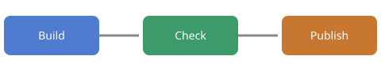

= Tidewater Release Handbook
:toc:
:description: How the team builds, checks and ships a Tidewater release.
:snippets: snippets

This handbook is the single source for a release.
Each chapter lives in its own file and comes in through an include directive.

NOTE: Read the xref:Reference.adoc#exit-codes[exit codes] before you start a release on a new machine.

== Release checklist

[cols="1,3,1",options="header"]
|===
|Step |What to do |Owner

|1
|Freeze the main branch and tag the release candidate.
|Lead

|2
|Run the full test suite on the build server.
|CI

|3
|Write the release notes from the merged pull requests.
|Docs

|4
|Publish the packages and announce the release.
|Lead
|===

TIP: Keep the checklist short. Put the long instructions in the chapters below.

include::chapters/install.adoc[leveloffset=+1]

include::chapters/configure.adoc[leveloffset=+1]

== Deploy

The deploy script runs the same steps on every machine.

[source,bash]
----
include::{snippets}/deploy.sh[tag=deploy]
----

.Release flow

WARNING: Never deploy on a Friday afternoon.

== Related documents

* xref:Reference.adoc[Command reference]
* xref:Glossary.adoc[Glossary] (not written yet)
* <<_release_checklist,Back to the checklist>>
